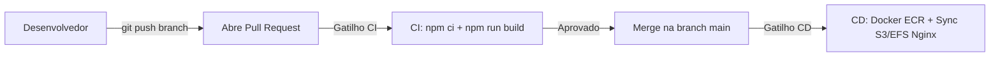

# SGPJ Frontend
# Padrão de Commits e Fluxo de Desenvolvimento

Este documento define o padrão de commits e o fluxo de trabalho do projeto frontend (React).
O objetivo é manter o código organizado, padronizado e fácil de entender por qualquer pessoa do time.

---

# Padrão de Commits (Conventional Commits)

Os commits seguem um padrão semântico, ou seja, cada mensagem indica claramente o que foi feito.

## Tipos de commit

* `feat` -> Adiciona uma nova funcionalidade
* `fix` -> Corrige um bug
* `docs` -> Alterações na documentação
* `test` -> Alterações/criação de testes
* `build` -> Mudanças em build ou dependências
* `perf` -> Melhorias de performance
* `style` -> Formatação de código (lint, espaçamento, etc)
* `refactor` -> Refatoração sem alterar comportamento
* `chore` -> Configurações e tarefas gerais
* `ci` -> Integracao contínua
* `raw` -> Arquivos de configuração/dados
* `cleanup` -> Limpeza de código desnecessário
* `remove` -> Remoção de código ou arquivos

## Exemplos

```bash
feat: adiciona tela de dashboard
fix: corrige validação de login
docs: atualiza README
```

---

# Fluxo de Desenvolvimento com Branches

## Conceito

Neste projeto, nunca trabalhamos diretamente na branch `development`.
Toda alteração deve ser feita em uma branch separada.

Isso permite:

* Trabalhar em paralelo com outras pessoas
* Evitar conflitos
* Garantir revisão de código antes de integrar

---

## Passo a passo

### 1. Criar uma nova branch

Sempre comece garantindo que sua `development` está atualizada:

```bash
git checkout development
git pull origin development
git checkout -b feat/nome-da-feature
```

Exemplos de nome:

```bash
feat/adiciona-dashboard
fix/corrige-login
```

---

### 2. Desenvolver

Faça suas alterações normalmente e commit seguindo o padrão:

```bash
git add .
git commit -m "feat: adiciona dashboard inicial"
```

---

### 3. Atualizar sua branch

Antes de subir sua branch, sincronize com a `development`:

```bash
git add .
git stash
git pull origin development
git stash apply
```

---

### 4. Subir a branch

```bash
git add .
git commit -m "feat: ajustes finais da interface"
git push origin feat/nome-da-feature
```

---

### 5. Abrir Pull Request (PR)

No GitHub:

* Acesse o repositório
* Clique em **"Compare & pull request"**
* Configure:

		* Base: `development`
		* Compare: sua branch
* Crie o PR

---

### 6. Code Review

* Adicione 2 revisores
* Aguarde aprovação
* Faça ajustes se necessário

---

### 7. Merge

Após aprovação:

* O PR será mergeado na `development`
* Sua branch pode ser removida

---

## Boas práticas

* Nunca commitar direto na `development`
* Usar nomes claros nas branches
* Fazer commits pequenos e objetivos
* Sempre seguir o padrão de commit
* Atualizar sua branch antes de abrir PR

---

## Resumo

* Cada tarefa -> uma branch
* Desenvolve -> commit -> push
* Abre PR -> revisão -> merge

---

# Setup do Projeto Frontend (React)

## Pré-requisitos

* Node.js 18+ (recomendado LTS)
* npm 9+ (ou gerenciador equivalente)

## Instalação

```bash
npm install
```

## Executar em desenvolvimento

```bash
npm run dev
```

## Build de producao

```bash
npm run build
```

## Preview da build

```bash
npm run preview
```

---

## Exemplo de como criar um arquivo .env

Crie um arquivo `.env` na raiz do projeto com os valores apropriados para seu ambiente:

```text
VITE_API_BASE_URL=http://localhost:8080
VITE_APP_NAME=SGPJ Frontend
VITE_AUTH_COOKIE_NAME=authToken
```

Observação:

* Variáveis expostas no frontend (Vite) devem começar com `VITE_`.

---

# Fluxo de Requisição no Frontend

### Login

```text
POST /usuarios/login
	Body: { "email": "...", "senha": "..." }

	1. Tela de Login      -> coleta email e senha
	2. authService        -> envia credenciais para a API
	3. Backend            -> valida usuário e gera JWT
	4. Navegador          -> recebe cookie HttpOnly (authToken)
	5. Frontend           -> armazena dados públicos do usuário em estado global
	6. Resposta visual    -> redireciona para área autenticada
```

### Requisição autenticada

```text
GET /usuarios
	Cookie: authToken=<jwt>

	1. Frontend           -> dispara chamada HTTP para endpoint protegido
	2. Navegador          -> envia cookie automaticamente
	3. Backend            -> valida token e processa requisição
	4. Frontend           -> renderiza dados recebidos
	5. Erro 401/403       -> redireciona para login ou exibe aviso de sessão expirada
```

---

## Endpoints úteis (Backend)

* Swagger UI: http://localhost:8080/swagger-ui.html
* OpenAPI: http://localhost:8080/v3/api-docs

---

## Observações de integração

* Sempre validar CORS no backend para a URL do frontend em desenvolvimento.
* Preferir uso de cookie HttpOnly para token, evitando armazenamento sensível em `localStorage`.
* Padronizar tratamento de erro de API (401, 403, 500) em um cliente HTTP centralizado.


---

## 🚀 Fluxo de Integracao e Entrega Continua (CI/CD)

O Frontend conta com integração e entrega contínua automatizadas via **GitHub Actions**:



### 1. Integracao Continua (CI) — `.github/workflows/ci.yml`
* **Gatilho:** Todo **Pull Request** para `main` ou `develop`.
* **Ações:**
  * Instala dependências limpas com `npm ci` no Node.js 20.
  * Valida o processo de compilacao do Vite (`npm run build`).
  * Garante que nenhum código com erro de JSX/TypeScript ou dependência quebrada entre na branch principal.

### 2. Entrega Continua (CD) — `.github/workflows/cd.yml`
* **Gatilho:** Todo **Push / Merge** na branch `main`.
* **Ações:**
  * Gera a compilacao de producao com Vite (`npm run build`).
  * Constrói a imagem Docker baseada no Nginx Alpine e faz o push para o **Amazon ECR (`sgpj-frontend:latest`)**.
  * Sincroniza a pasta de assets `dist/` com o bucket S3 e atualiza o sistema de arquivos **EFS compartilhado** das EC2s públicas (`ec2-app-a` e `ec2-app-b`) via **AWS SSM**.
