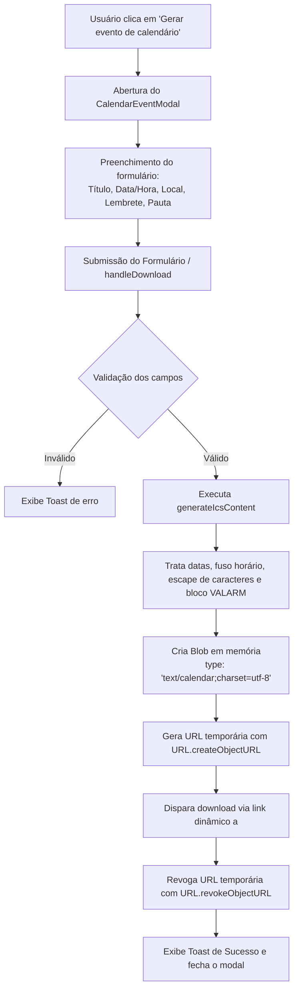

# Guia de Funcionamento: Geração e Exportação de Arquivos `.ics` (iCalendar)

Este documento explica tecnicamente e conceitualmente como funciona a funcionalidade de **Geração de Evento de Calendário (`.ics`)** implementada no **SGPJ (Sistema Gerenciador de Processos Judiciais)**.

---

## 1. O que é o Formato `.ics` (iCalendar)?

O formato `.ics` é o padrão aberto internacional definido pela especificação **[RFC 5545](https://datatracker.ietf.org/doc/html/rfc5545)** (*Internet Calendaring and Scheduling Core Object Specification*).

Ele permite que eventos, compromissos, tarefas e lembretes sejam exportados e importados de forma interoperável em qualquer software de calendário, como:
- **Google Agenda** (Google Calendar)
- **Microsoft Outlook** (Desktop, Web e Mobile)
- **Apple Calendar** (macOS, iOS e iPadOS)
- **Mozilla Thunderbird**
- Aplicativos nativos de calendário para Android e Windows.

---

## 2. Fluxo Geral de Geração

O processo ocorre 100% no lado do cliente (Client-Side / Frontend), sem necessidade de dependências externas ou chamadas ao servidor para compilar o arquivo.



---

## 3. Anatomia da Estrutura do Arquivo `.ics`

Abaixo está um exemplo real da estrutura de texto puro gerada pelo componente:

```ics
BEGIN:VCALENDAR
VERSION:2.0
PRODID:-//SGPJ//Sistema Gerenciador de Processos Judiciais//PT-BR
CALSCALE:GREGORIAN
METHOD:PUBLISH
BEGIN:VEVENT
UID:1724430000000-k8f9a2z@sgpj.adv.br
DTSTAMP:20260823T184500Z
DTSTART:20260825T143000
DTEND:20260825T153000
SUMMARY:Audiência de Instrução e Julgamento
DESCRIPTION:Comparecer com 15 minutos de antecedência.\nDocumentos: Procuração e CTPS.
LOCATION:2ª Vara do Trabalho de São Paulo - Fórum Ruy Barbosa
STATUS:CONFIRMED
TRANSP:OPAQUE
BEGIN:VALARM
ACTION:DISPLAY
DESCRIPTION:Lembrete: Audiência de Instrução e Julgamento
TRIGGER:-PT15M
END:VALARM
END:VEVENT
END:VCALENDAR
```

### Explicação das Propriedades:

| Propriedade | Significado | Descrição no SGPJ |
| :--- | :--- | :--- |
| `BEGIN:VCALENDAR` / `END:VCALENDAR` | Delimitador do Calendário | Inicia e finaliza o objeto do calendário. |
| `VERSION:2.0` | Versão da especificação | Exigida pelo padrão RFC 5545. |
| `PRODID` | Identificador do Produto | Identifica o SGPJ como o emissor do evento. |
| `CALSCALE:GREGORIAN` | Escala do Calendário | Calendário Gregoriano padrão. |
| `METHOD:PUBLISH` | Método de publicação | Informa que se trata de uma publicação de evento independente. |
| `BEGIN:VEVENT` / `END:VEVENT` | Objeto do Evento | Contém os dados do compromisso específico. |
| `UID` | Identificador Único Universal | Gerado unicamente usando timestamp + hash aleatório para evitar conflitos na agenda do usuário. |
| `DTSTAMP` | Timestamp de Emissão | Data e hora UTC em que o arquivo foi gerado (`YYYYMMDDTHHMMSSZ`). |
| `DTSTART` / `DTEND` | Início e Fim do Evento | Define o intervalo do compromisso (veja a seção de datas abaixo). |
| `SUMMARY` | Título do Evento | O nome do compromisso exibido na grade do calendário. |
| `DESCRIPTION` | Descrição / Pauta | Detalhes, observações, orientações ou links. |
| `LOCATION` | Localização | Endereço físico da vara/fórum ou link de sala virtual (Meet/Teams). |
| `STATUS:CONFIRMED` | Status | Indica que o compromisso está confirmado na agenda. |
| `TRANSP:OPAQUE` | Transparência de Horário | Marca o horário do usuário como "Ocupado". |
| `BEGIN:VALARM` / `END:VALARM` | Bloco de Alarme | Configura a notificação/lembrete do evento. |
| `TRIGGER` | Disparo do Alarme | Tempo relativo de antecedência (ex: `-PT15M` = 15 minutos antes). |

---

## 4. Detalhes de Implementação no Frontend

### 4.1. Tratamento de Datas e Modos de Horário

O componente suporta dois modos de compromisso:

1. **Evento com Horário Marcado (Horário Local Flutuante)**:
   - Formato: `DTSTART:YYYYMMDDTHHMMSS` (ex: `20260825T143000`).
   - Não atrela um fuso horário fixo rígido, permitindo que qualquer calendário no computador ou celular do usuário importe o evento respeitando o horário civil selecionado.

2. **Evento de Dia Inteiro (`isAllDay`)**:
   - Formato: `DTSTART;VALUE=DATE:YYYYMMDD` (ex: `DTSTART;VALUE=DATE:20260825`).
   - Pela norma RFC 5545, a data de término de evento de dia inteiro (`DTEND`) é **exclusiva**, ou seja, para um evento que ocorre durante todo o dia 25/08, o `DTEND` deve ser calculado para o dia seguinte (`20260826`). A função `getAllDayEndDate` realiza esse cálculo automaticamente.

### 4.2. Sanitização e Escape de Caracteres (RFC 5545)

No formato iCalendar, certos caracteres possuem significado estrutural e devem ser escapados com barra invertida `\`:
- Vírgulas: `,` $\rightarrow$ `\,`
- Pontos e vírgulas: `;` $\rightarrow$ `\;`
- Barras invertidas: `\` $\rightarrow$ `\\`
- Quebras de linha: `\n` $\rightarrow$ `\n` literal

```javascript
const escapeIcsText = (str) => {
  if (!str) return "";
  return str
    .replace(/\\/g, "\\\\")
    .replace(/;/g, "\\;")
    .replace(/,/g, "\\,")
    .replace(/\r?\n/g, "\\n");
};
```

### 4.3. Lembretes e Alarmes (`VALARM`)

As opções de lembretes utilizam a sintaxe de duração ISO 8601 negativa:
- **15 minutos antes**: `-PT15M`
- **30 minutos antes**: `-PT30M`
- **1 hora antes**: `-PT1H`
- **2 horas antes**: `-PT2H`
- **1 dia antes**: `-P1D`
- **2 dias antes**: `-P2D`
- **1 semana antes**: `-P1W`

Quando selecionado, o bloco `BEGIN:VALARM` é injetado no evento:
```javascript
const alarmBlock =
  reminder && reminder !== "0"
    ? [
        "BEGIN:VALARM",
        "ACTION:DISPLAY",
        `DESCRIPTION:Lembrete: ${escapeIcsText(title)}`,
        `TRIGGER:${reminder}`,
        "END:VALARM",
      ].join("\r\n")
    : "";
```

### 4.4. Download Automático sem Backend

O download utiliza a API de `Blob` do navegador:

```javascript
// 1. Cria o blob com charset UTF-8
const blob = new Blob([icsString], { type: "text/calendar;charset=utf-8" });

// 2. Cria URL temporária
const url = URL.createObjectURL(blob);

// 3. Cria link dinâmico e clica programaticamente
const link = document.createElement("a");
link.href = url;
link.setAttribute("download", filename);
document.body.appendChild(link);
link.click();

// 4. Limpeza da memória
document.body.removeChild(link);
URL.revokeObjectURL(url);
```

---

## 5. Como o Usuário Importa o Arquivo Gerado

1. **Google Agenda (Google Calendar)**:
   - No computador: Abra o Google Agenda $\rightarrow$ Clique no ícone de engrenagem $\rightarrow$ **Configurações** $\rightarrow$ **Importar e Exportar** $\rightarrow$ Selecione o arquivo `.ics` baixado.
   - Ou simplesmente clique duas vezes no arquivo baixado caso o Google Agenda / cliente padrão esteja configurado.
2. **Microsoft Outlook**:
   - Dê dois cliques no arquivo `.ics` baixado $\rightarrow$ O Outlook abrirá a janela do evento $\rightarrow$ Clique em **Salvar e Fechar**.
3. **Apple Calendar (Mac / iPhone / iPad)**:
   - Dê dois cliques no arquivo `.ics` $\rightarrow$ O aplicativo Calendário perguntará em qual agenda deseja adicionar o compromisso $\rightarrow$ Clique em **OK**.

---

## 6. Arquivos Envolvidos no Código-Fonte

- [`CalendarEventModal.jsx`](file:///C:/Users/leona/OneDrive/%C3%81rea%20de%20Trabalho/Frontend/src/app/components/CalendarEventModal.jsx): Componente React que renderiza o formulário e executa a lógica de montagem e download do arquivo `.ics`.
- [`calendar-event-modal.css`](file:///C:/Users/leona/OneDrive/%C3%81rea%20de%20Trabalho/Frontend/src/styles/calendar-event-modal.css): Folha de estilos do modal.
- [`HomePage.jsx`](file:///C:/Users/leona/OneDrive/%C3%81rea%20de%20Trabalho/Frontend/src/app/pages/HomePage.jsx): Página inicial que contém o botão de acionamento do modal.
